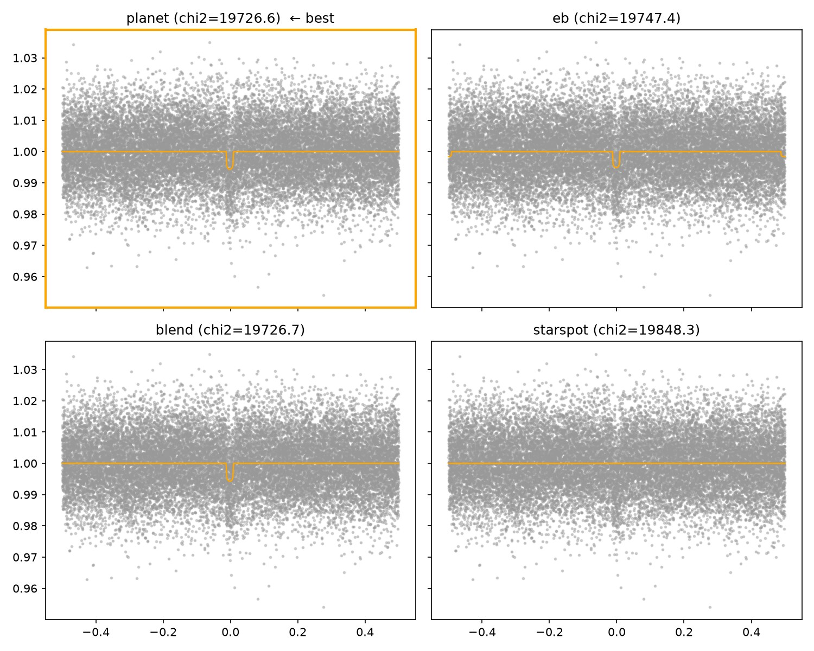
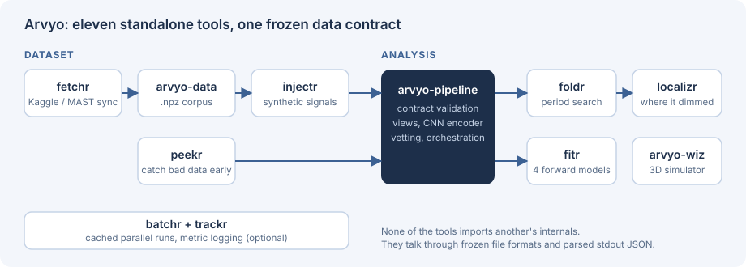
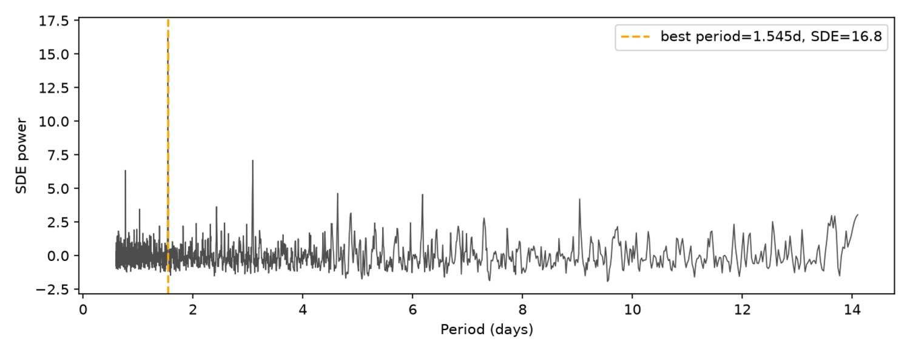
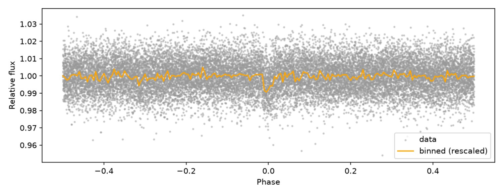
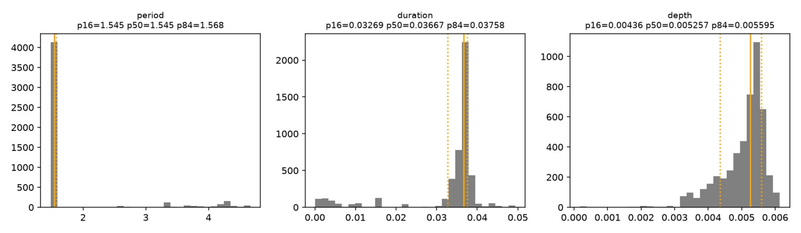
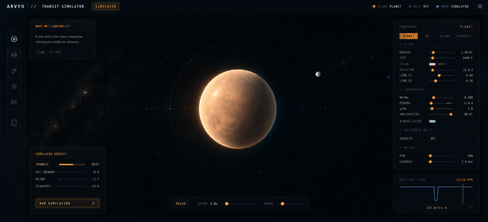
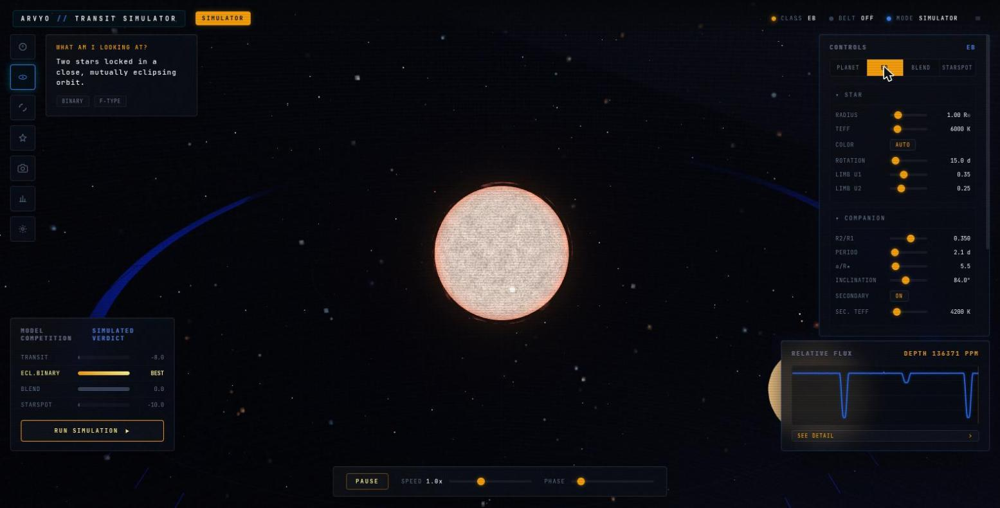
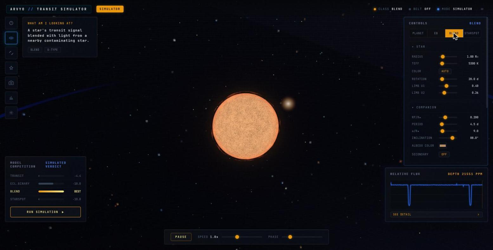
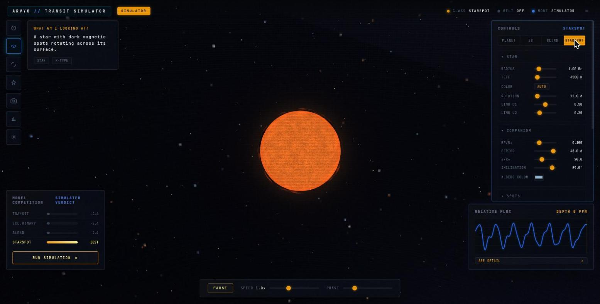

<div align="center">

# ARVYO
### A star dims. Something crossed it. **Arvyo works out what.**

[](#) [](#) [](#the-eleven-repositories) [](LICENSE)



</div>

Finding a dip in a star's brightness is the easy part. **A dip alone does not tell you what made it.** A planet makes one. So does a faint companion star eclipsing its partner, an unrelated star blended into the same aperture, or a big cold starspot rotating across a planetless sun. Most false positives in the exoplanet catalogues are exactly this, and the usual fix is a queue of human experts.

Arvyo does not pattern-match light curves. It **rebuilds each of the four hypotheses from physics, fits all four to the same data, and asks which one the evidence prefers.** That is analysis-by-synthesis, and it is why the answer comes with a reason attached instead of a confidence score.

| 1.545 d | SDE 16.8 | 0.013% | 11 |
|:---:|:---:|:---:|:---:|
| period found on a real TESS sample (TIC 138644215) | against a detection gate of 7.0 | error against the sample's recorded period | standalone repos, one frozen data contract |

## 40-second demo

<p align="center"><a href="https://youtu.be/nxsViUQj-1k"></a><br><sub>▶ Watch the 40-second demo on [YouTube](https://youtu.be/nxsViUQj-1k) (with sound), or grab the [mp4](docs/media/demo.mp4). Every image in it is a real screenshot or run from this repo.</sub></p>

## The eleven repositories



<sub>Arrows show the typical order of use, not imports: no tool imports another's internals.</sub>

| Dataset | | Analysis | |
|---|---|---|---|
| [`arvyo-data`](https://github.com/nikhilcherry/arvyo-data) | the `.npz` corpus everything reads | [`arvyo-pipeline`](https://github.com/nikhilcherry/arvyo-pipeline) | the spine: contract validation, CNN encoder, vetting |
| [`fetchr`](https://github.com/nikhilcherry/fetchr) | Kaggle/MAST sync and verification | [`foldr`](https://github.com/nikhilcherry/foldr) | phase folding, BLS/TLS period search |
| [`injectr`](https://github.com/nikhilcherry/injectr) | synthetic signals, so there is labelled truth | [`fitr`](https://github.com/nikhilcherry/fitr) | fits and ranks the four forward models |
| [`peekr`](https://github.com/nikhilcherry/peekr) | catches NaNs and outliers at the source | [`localizr`](https://github.com/nikhilcherry/localizr) | pixel-level localisation: where on the detector it dimmed |

Plus [`batchr`](https://github.com/nikhilcherry/batchr) (cached, crash-safe parallel runs), [`trackr`](https://github.com/nikhilcherry/trackr) (optional run logging) and [`arvyo-wiz`](https://github.com/nikhilcherry/arvyo-wiz) (the 3D simulator below).

## The result worth reading

All four models are fitted to the same data, and `best_explanation` picks **planet**, matching the true label. **But it very nearly didn't.** At `crowdsap = 0.44` (more than half the light in the aperture is not the target's) the blend model's free dilution parameter can track the planet almost exactly. On raw chi² the two were a near-tie, 19726.59 against 19726.71, so a different noise seed would flip the winner.

So models are ranked by **BIC**, which charges each model for its free parameters. Blend pays for its extra one and the comparison stops being a coin flip. The degeneracy is pinned in `tests/test_end_to_end.py` so it cannot silently regress.

| The periodogram: one clean peak | The fold at 1.545 days | Posteriors, seeded by the period search |
|---|---|---|
|  |  |  |

Every stage, with every figure: [`docs/WALKTHROUGH.md`](docs/WALKTHROUGH.md). Nothing is cherry-picked; `scripts/smoke_run.py --make-docs-figures --seed 42` regenerates all of it.

## Decisions worth knowing

- **Rank by BIC, not chi².** See above: the near-tie was the most interesting thing in the project.
- **Eleven repos, one frozen contract.** The two halves meet at a single `.npz` schema (`arvyo/contract.py`, versioned `SCHEMA_VERSION = "1.0"`). Changing it means bumping the version and updating both READMEs. The pipeline only reads the dataset, never writes into it.
- **Tools talk through CLIs, not imports.** The glue layer invokes the published commands and parses stdout JSON and exit codes (`0` clear, `3` ambiguous, `4` no significant signal). `fitr`'s output is embedded verbatim, never reshaped.
- **Skip the expensive step when it can't help.** If the period search's SDE and SNR are both under the gate, the target returns `no_period` immediately and `fitr` never runs.
- **Report the number that doesn't flatter you.** On this sample odd transits are visibly deeper than even ones (0.0060 vs 0.0043), exactly what an eclipsing-binary false positive would show. The README says so; the secondary-eclipse check and transit shape are what argue for a planet.

## Seeing it: the simulator

[`arvyo-wiz`](https://github.com/nikhilcherry/arvyo-wiz) is the same physics made draggable. Build any of the four scenarios by hand, watch the 3D system rebuild and see the exact light curve a telescope would record.

| planet | eclipsing binary |
|---|---|
|  |  |
| **blend** | **starspot** |
|  |  |

## Honest status

- The BIC ranking, the vetting checks and the `.npz` contract are implemented, tested and reproducible from a fresh clone.
- `localizr` is opt-in and needs network access to MAST and Gaia. It runs only where model comparison structurally cannot decide: a clear planet or blend winner, or an ambiguous verdict with the two tied.
- `benchmarks/` documents how to run ExoMiner and triceratops as comparison oracles. Those comparisons are set up, not yet reported here.

## Reproduce

```bash
python3 -m venv venv && source venv/bin/activate && pip install -r requirements.txt
pytest                                                   # contract, views, end-to-end
python scripts/smoke_run.py --make-docs-figures --seed 42  # exits 0 only if every stage on every sample passed
```

A fully pinned setup (exact versions, glue tools at specific commits, a sibling-clone health check) is in `docs/finale_setup.md` in `arvyo-pipeline`.

<div align="center"><sub>Built for the Bharatiya Antariksh Hackathon 2026, PS-7. Eleven repositories, one frozen contract, four hypotheses that have to argue it out.</sub></div>
