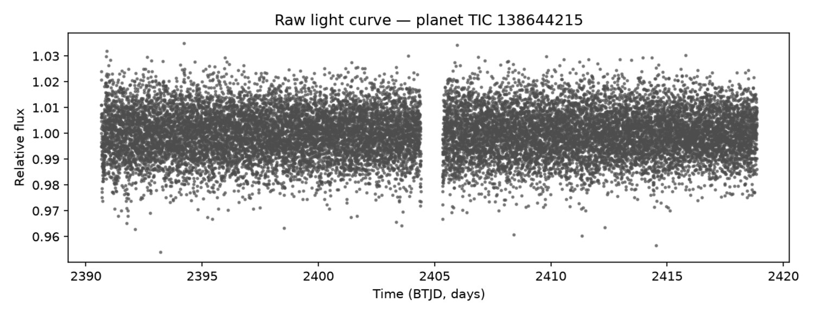
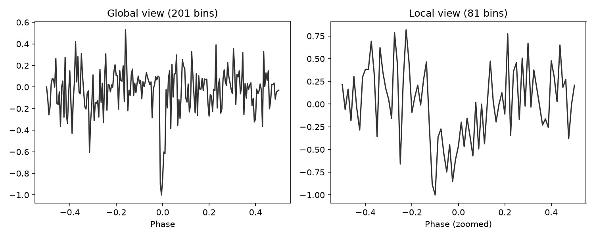
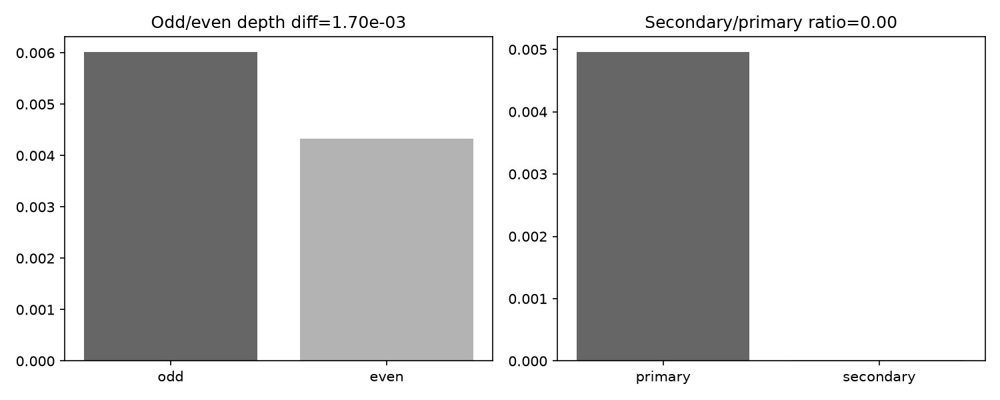
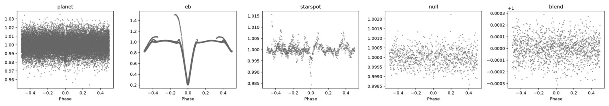
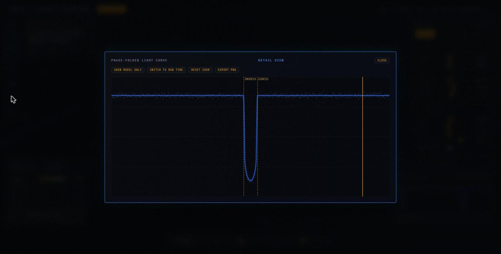
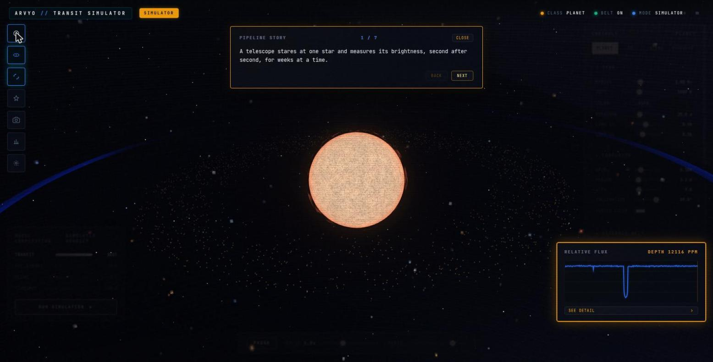
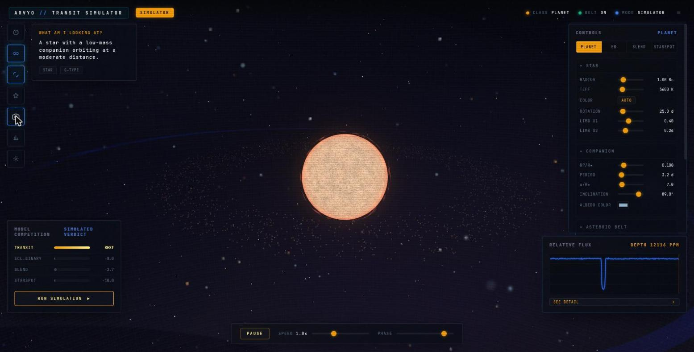

<div align="center">

# ARVYO

### A star dims. Something crossed it. **Arvyo works out what.**

[](#the-eleven-repositories)
[](#)
[](#the-data-contract)
[](LICENSE)

</div>


---

## The problem nobody tells you about

Finding a dip in a star's brightness is the easy part. A telescope stares at one star for weeks, and the brightness drops by a fraction of a percent. Congratulations — you have found *something*.

**A dip alone does not tell you what made it.** A planet crossing the disc makes one. So does a faint companion star eclipsing its partner. So does a completely unrelated star, blended into the same aperture, doing either of those things a few pixels away. So does a big cold starspot rotating across the surface of a perfectly ordinary, planetless sun.

All four produce a dip. At a glance, they look alike. Most of the false positives in the exoplanet catalogues are exactly this, and the traditional answer is a queue of humans with domain expertise.

> Arvyo does not classify light curves by pattern-matching them.
> It **rebuilds each hypothesis from physics**, fits all four to the same data, and asks which one the evidence actually prefers.

That's analysis-by-synthesis, and it is why the answer comes with a reason attached rather than a confidence score.

---

## The eleven repositories

Every tool below is standalone — its own repository, its own README, its own tests, its own CLI. **None of them imports another's internals.** They speak to each other through frozen file formats and parsed stdout JSON, which is the only reason eleven moving parts can be recombined without a rewrite.

### The dataset half

| repo | what it does |
|---|---|
| [`arvyo-data`](https://github.com/nikhilcherry/arvyo-data) | The dataset builder. Produces the `.npz` corpus everything downstream reads |
| [`fetchr`](https://github.com/nikhilcherry/fetchr) | Kaggle/MAST sync and verification — get the light curves, prove they arrived intact |
| [`injectr`](https://github.com/nikhilcherry/injectr) | Synthetic injection of planet / EB / blend / starspot signals, so there is labelled truth to test against |
| [`peekr`](https://github.com/nikhilcherry/peekr) | Universal scientific data file explorer. Catches NaNs, near-constant flux and outliers at the source, instead of letting them surface as a confusing failure three stages later |

### The analysis half

| repo | what it does |
|---|---|
| [`arvyo-pipeline`](https://github.com/nikhilcherry/arvyo-pipeline) | The spine. Contract validation, view generation, the CNN encoder, vetting, and the orchestration glue |
| [`foldr`](https://github.com/nikhilcherry/foldr) | Phase-folding and period search (BLS/TLS) — find the candidate period and epoch |
| [`fitr`](https://github.com/nikhilcherry/fitr) | Analysis-by-synthesis: fits all four competing forward models and ranks them |
| [`localizr`](https://github.com/nikhilcherry/localizr) | Pixel-level transit localisation by target-pixel-file difference imaging — *where* on the detector the dimming happened |

### Orchestration and interface

| repo | what it does |
|---|---|
| [`batchr`](https://github.com/nikhilcherry/batchr) | Content-hash cached, crash-safe parallel batch runner — `make` for functions |
| [`trackr`](https://github.com/nikhilcherry/trackr) | Run and metric logging. Optional, and never fails the run |
| [`arvyo-wiz`](https://github.com/nikhilcherry/arvyo-wiz) | The interactive 3D simulator — build any of the four scenarios by hand and watch the light curve respond |

---

## How a detection actually happens

Every figure below is generated from one real sample — **TIC 138644215**, sector 40, 19,611 points at two-minute cadence over a 28.2-day baseline, with `crowdsap = 0.44`, meaning **more than half the light in the aperture is not from the target star**. That last number is why this is a hard case rather than a demo.

Nothing is cherry-picked or hand-edited. `scripts/smoke_run.py --make-docs-figures --seed 42` regenerates all of it from a fresh clone.

### 1 · The input

A full TESS sector at two-minute cadence — dense enough that individual transits are invisible by eye at this scale.



### 2 · The representation

201-bin global and 81-bin local phase-folded views — the model's actual input, not the raw series.



### 3 · The period search

One dominant, clean peak at **1.545 days, SDE 16.8** — more than double the 7.0 detection gate. It recovers the sample's own recorded period of 1.54493 d to within **0.013%**.


### 4 · The fold


### 5 · The four hypotheses — and the part that matters

All four forward models are fitted to the same data. `best_explanation` picks **planet**, matching the true label.

**But it very nearly didn't, and the reason is the most interesting thing in this repository.** At `crowdsap = 0.44`, the blend model's free `dilution` parameter can track the planet model almost exactly. On raw chi² the two were a near-tie — 19726.59 against 19726.71, a difference of 0.12 out of ~19,700. A different noise draw or random seed would flip that winner.

So ranking is by **BIC**, not chi²: chi² penalised by `n_params × log(n_points)`. Blend pays for its extra free parameter, and the comparison becomes robust instead of a coin flip. The same planet/blend degeneracy is pinned down in `tests/test_end_to_end.py` so it cannot silently regress.

### 6 · Posteriors

Period, duration and depth marginals from `fit_emcee`, seeded at the period search's answer. Tight marginals reflect both a clean fit and an accurately recovered period.


### 7 · Vetting — including the number that doesn't flatter the result

Odd/even and secondary-eclipse checks at the recovered ephemeris.

Odd-transit depth (0.0060) comes out **visibly deeper** than even-transit depth (0.0043) — a difference of 1.70e-3. That is real per-transit scatter on a single, moderately diluted sector. It is also exactly the signature a genuine eclipsing-binary false positive would show, **so this number alone does not clear the target.** It is the secondary-eclipse check — depth ratio ~0.003, no secondary detected — together with the transit shape that argues for a planet here.



### 8 · The classes, side by side

All five committed samples, including a `blend` drawn from **real Kepler DR25 centroid-offset data** (KIC 6974867) rather than a simulation.



---

## The data contract

Two halves of the project, built to be worked on independently, meet at exactly one interface — a frozen `.npz` schema in `arvyo/contract.py`:

```python
SCHEMA_VERSION = "1.0"

REQUIRED_ARRAYS = ["time", "flux", "flux_err"]
OPTIONAL_ARRAYS = ["flux_raw"]          # present for starspot/null classes
REQUIRED_META   = ["tic_id", "label", "sector"]
OPTIONAL_META   = ["period_days", "epoch_btjd", "crowdsap", "mission",
                   "augmented", "injection_params"]
LABELS          = ["planet", "eb", "blend", "starspot", "null", "unknown"]
```

Any change to it requires bumping `SCHEMA_VERSION` and updating **both** repos' READMEs. `arvyo-pipeline` never writes into `arvyo-data`; it only reads.

The same discipline governs the glue layer. `worker.py` and `run.py` never import `foldr`, `fitr` or `localizr` internals — they invoke the published CLIs and parse stdout JSON and exit codes. `fitr`'s output is embedded verbatim under `model_fit`, never reshaped. Exit codes carry meaning: `0 → clear`, `3 → ambiguous`, `4 → no_significant_signal`.

And there is a short circuit that saves most of the compute: if the period search's SDE and SNR both fall under the gate, the target returns `no_period` immediately and **`fitr` is never run**.

---

## Seeing it, not just reading it

[`arvyo-wiz`](https://github.com/nikhilcherry/arvyo-wiz) is the same physics made draggable. Build any of the four scenarios by hand, watch the 3D system rebuild in real time, and see the exact light curve a telescope would record.


The point of the simulator is the comparison — the same dip, four different causes:

| eclipsing binary | blend |
|---|---|
|  |  |

| starspot | the model competition |
|---|---|
|  |  |





---

## Reproducing it

```bash
python3 -m venv venv && source venv/bin/activate
pip install -r requirements.txt

python -m arvyo.contract ../arvyo-data/data/processed   # validate the corpus
pytest                                                   # contract, views, end-to-end
python scripts/smoke_run.py --make-docs-figures --seed 42
```

The smoke run exits `0` only if every stage on every sample passed, `1` if any failed, `2` if no samples were found. The figures in this README are its output — regenerate them and diff against what is committed.

For a fully pinned setup — exact dependency versions, all glue-layer tools installed from `git+https` at specific commit SHAs, a sibling-clone health check and a smoke test — see `docs/finale_setup.md` in `arvyo-pipeline`. That is the canonical copy-pasteable path; the block above is the fast one.

---

## Honest status

- The BIC ranking, the vetting checks and the `.npz` contract are implemented, tested, and reproducible from a fresh clone.
- `localizr` is **opt-in** and needs network access to MAST and Gaia. It runs only for the case it exists to resolve: a clear `planet` or `blend` winner, or an ambiguous verdict with the two tied. That centroid-offset test is the real discriminator that model comparison structurally cannot provide.
- `benchmarks/` documents how to run ExoMiner and triceratops as comparison oracles. Those comparisons are set up, not yet reported here.

---

<div align="center">

**Arvyo** — built for the Bharatiya Antariksh Hackathon 2026, PS-7.

Eleven repositories, one frozen contract, and four hypotheses that have to argue it out.

</div>
